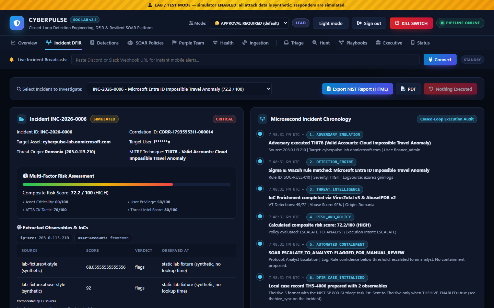
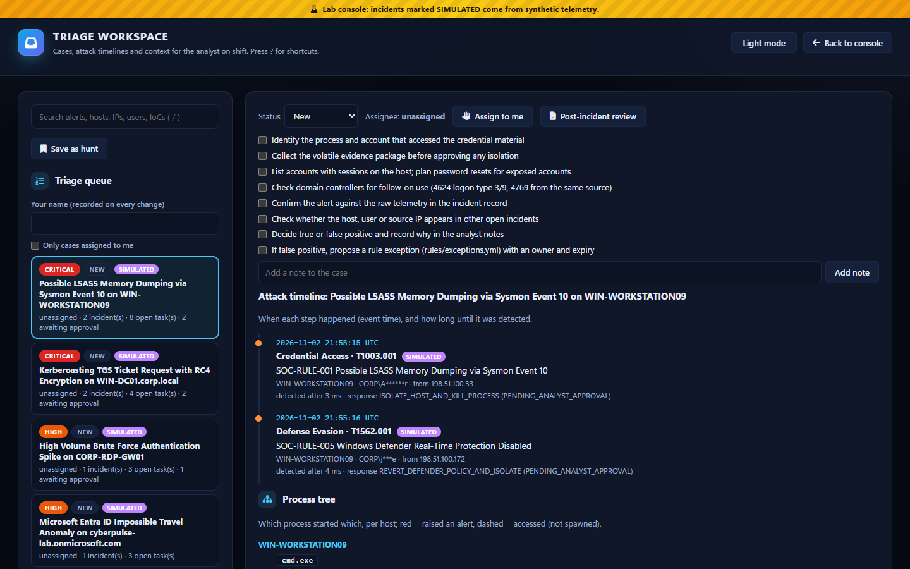
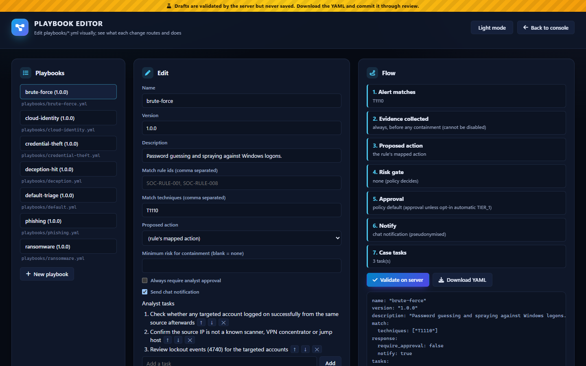
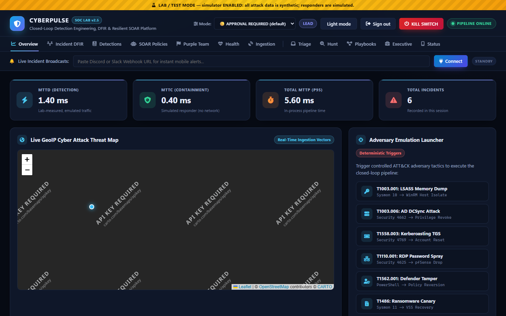
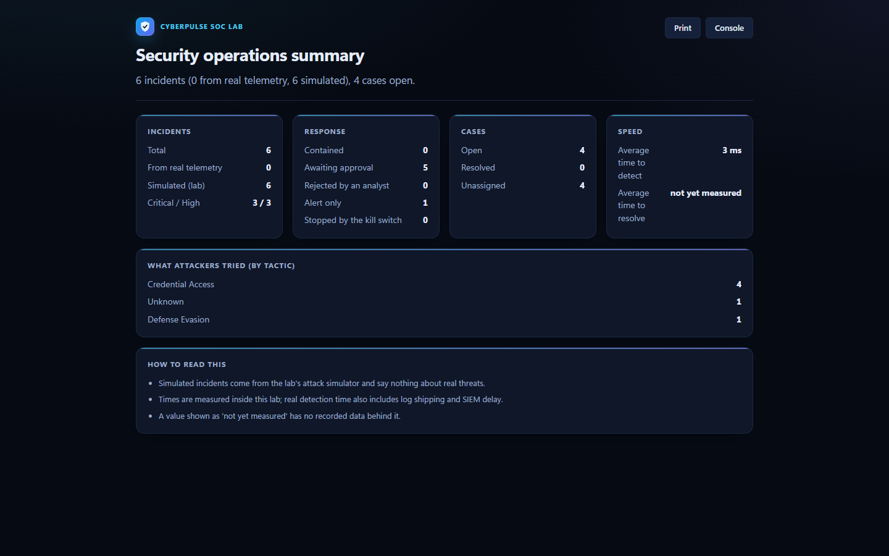
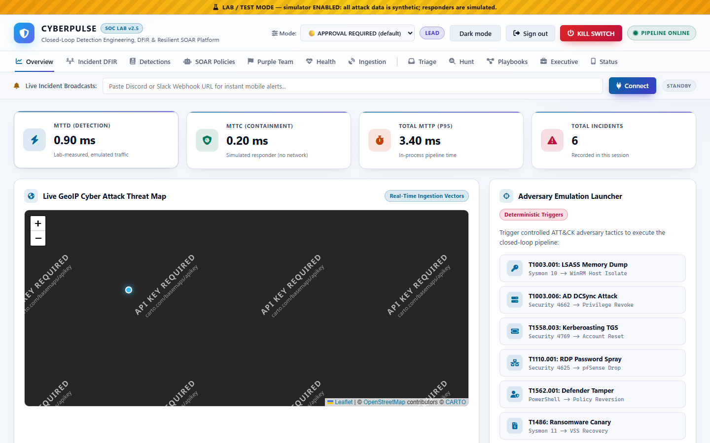
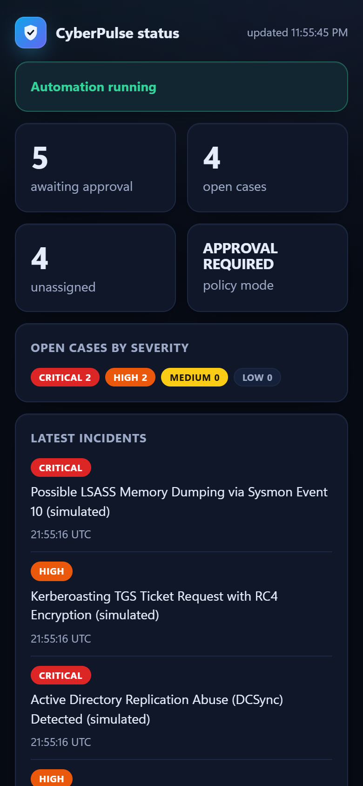
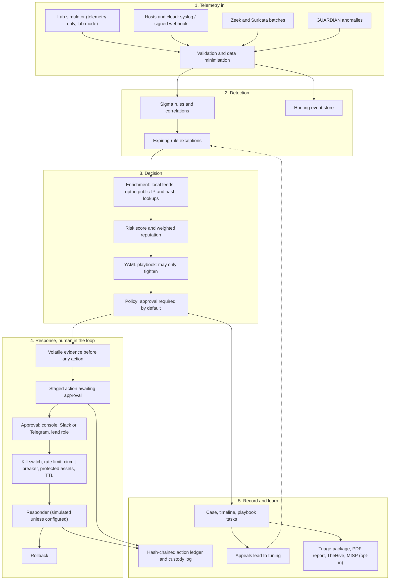

<div align="center">


# CyberPulse SOC Suite

**A detection-engineering and SOAR lab that measures itself honestly.**

Sigma rules evaluated as code · explainable risk scoring · human-approved containment with rollback · a triage console · every number generated by a script in the repo

[](https://github.com/lumidren/CyberPulse-SOC-Suite/actions)
-yellowgreen)


[Quickstart](#-quickstart) · [Console tour](#%EF%B8%8F-console-tour) · [Architecture](#%EF%B8%8F-architecture) · [Limitations](#%EF%B8%8F-limitations) · [Metrics](docs/METRICS.md) · [Case study](docs/CASE_STUDY.md) · [What I missed](docs/WHAT_I_MISSED.md)

<br>



</div>

> **⚠️ LAB USE ONLY.** CyberPulse is a training and portfolio lab. **Never run the
> simulator, the SOAR engine or any deployment artefact against production
> systems or any network you do not own or are not explicitly authorised in
> writing to test.** The simulator only emits synthetic telemetry, but the
> configurations and playbooks describe real defensive actions.

## ✨ What it is

CyberPulse models the path a SOC alert takes, from raw telemetry to a closed case, in one
Python process you can read end to end:

| | |
| :--- | :--- |
| 🔎 **Detection as code** | The engine evaluates the Sigma files themselves. Each rule has positive and negative samples, a versioned SOAR mapping, a changelog, a write-up and a runbook. |
| 🧮 **Explainable decisions** | A weighted risk score (rule, tactic, asset, user, threat intel, repeats) feeds YAML playbooks that may only tighten the policy. |
| 🧑‍⚖️ **Humans approve** | Containment waits for a lead's approval by default. Opt-in automation has a kill switch, rate limits, protected assets, TTLs and rollback. |
| 🧾 **Everything recorded** | A hash-chained action ledger, chain-of-custody log, case timelines and exportable triage packages. |
| 🧪 **Measured, not claimed** | Coverage, validation, evasion and purple-team pages are generated by scripts, and tests fail when a page goes stale. |
| 🛡️ **Safe by construction** | The simulator emits telemetry only, inside a lab CIDR allowlist, and refuses to run without an explicit lab flag. |

### At a glance

<!-- glance:start -->
| Measure | Value | Source |
| :--- | :---: | :--- |
| Detection content | 51 single-event rules + 4 correlations | [METRICS.md](docs/METRICS.md) |
| Scripted attack runs detected by the expected rule | 60/60 | [VALIDATION_RESULTS.md](docs/VALIDATION_RESULTS.md) |
| Benign baseline events alerting | 0/600 (119 suppressed by exceptions) | [VALIDATION_RESULTS.md](docs/VALIDATION_RESULTS.md) |
| Precision before exceptions | 0.335 | [METRICS.md](docs/METRICS.md) |
| Evasion variants that bypass their rule | 11/16 | [EVASION.md](docs/EVASION.md) |
| Target ATT&CK techniques with a rule | 27/36 | [coverage/GAPS.md](docs/coverage/GAPS.md) |
<!-- glance:end -->

All of it is synthetic data written by the same author as the rules: a regression check, not
evidence of real-world detection. `tests/test_readme_sections.py` fails if a figure above
stops matching the generated metrics page.

---

## 🚀 Quickstart

**Docker (one command)**

```bash
docker compose up --build
```

Open **http://127.0.0.1:5000** and sign in with the key printed in the log
(`docker compose logs cyberpulse | grep "Development API key"`). The container is a
declared lab (`CYBERPULSE_LAB_MODE=true`), runs read-only without capabilities, defaults
to approval-required containment and is published on loopback only. The full Wazuh /
OpenSearch / TheHive stack is in `deploy/docker-compose.yml`.

**Local Python**

```bash
git clone https://github.com/lumidren/CyberPulse-SOC-Suite.git
cd CyberPulse-SOC-Suite
python -m venv venv
source venv/bin/activate            # Windows: .\venv\Scripts\activate

# Hash-pinned dependencies; dev tools are only needed for tests and lint
pip install --require-hashes -r requirements.txt
pip install --require-hashes -r requirements-dev.txt
pip install --require-hashes -r requirements-typecheck.txt   # mypy (Linux/64-bit wheels)

CYBERPULSE_LAB_MODE=true python server.py    # then open http://localhost:5000
```

**Tests, lint and type-check** (all run in CI):

```bash
CYBERPULSE_LAB_MODE=true python -m unittest discover -s tests -p "test_*.py" -v
ruff check .
mypy
```

With coverage (CI fails below the floor in `.coveragerc`):

```bash
CYBERPULSE_LAB_MODE=true coverage run -m unittest discover -s tests -p "test_*.py"
coverage report
```

The coverage badge shows the figure measured on the date in the badge; the CI job summary shows the current value.

---

## 🖥️ Console tour

The web console is plain HTML, CSS and JavaScript served by `server.py`, in dark and light
themes. Screenshots are produced by `python scripts/capture_screenshots.py` from a throwaway
local lab server with synthetic incidents.

<table>
  <tr>
    <td width="50%"><br><b>Triage workspace</b>: case queue, playbook tasks, attack timeline, process tree and keyboard shortcuts.</td>
    <td width="50%"><br><b>Playbook editor</b>: edit a playbook, see the flow it produces and validate it on the server.</td>
  </tr>
  <tr>
    <td width="50%"><br><b>Overview</b>: lab-measured KPIs, the threat map and the adversary emulation launcher. The map needs a CARTO key for its tiles.</td>
    <td width="50%"><br><b>Executive summary</b>: one printable page that separates real from simulated incidents.</td>
  </tr>
  <tr>
    <td width="50%"><br><b>Light theme</b>: follows the OS setting, with a toggle remembered per browser.</td>
    <td width="50%" align="center"><br><b>Mobile status</b>: read-only, for the on-call phone.</td>
  </tr>
</table>

| Area | What you can do |
| :--- | :--- |
| **Overview** | GeoIP threat map, lab-measured KPIs and the attack simulation launcher. |
| **Incident DFIR** | Attack graph, template-based triage summary, pre-containment volatile evidence, synthetic AD blast radius, approval and one-click rollback. |
| **Detections** | Searchable rulebase linked to Detection Engineering Lifecycle (DELC) write-ups. |
| **SOAR Policies** | Risk tiers, dry-run and approval modes. |
| **Purple Team** | Replay APT29 and LockBit kill chains through the pipeline. |
| **Health** | Connection probes for Wazuh, OpenSearch, WinRM and external APIs. |
| **Ingestion** | UDP 5514 syslog listener statistics and a webhook ingestion gateway. |
| **Triage · Hunt · Playbooks** | Case workspace, pivoting hunt workbench with a plain-English query translator, and the playbook editor. |
| **Executive · Status** | Printable summary and a phone-sized read-only status view. |

Roles: the **lead** approves and changes policy, an **analyst** triages, proposes and hunts,
an **auditor** reads. The server enforces every role; the console only hides what a role cannot use.

---

## 🏛️ Architecture



The diagram is Mermaid (rendered by GitHub); every label is quoted so it renders on GitHub and in MkDocs.
Checked with Mermaid 10.9.1 in a browser.

**What is deployable and what is a test harness.** The repository keeps the two apart:

| Deployable artefacts (untested on real traffic) | Python simulation and validation harness |
| :--- | :--- |
| 51 Sigma rules + 4 correlations (`rules/sigma/`) | Adversary emulation generator (Sysmon / EVTX shaped) |
| Wazuh XML rules, Sysmon v14 config, WDAC driver blocklist | Multi-factor risk and policy decision engine |
| Splunk `savedsearches.conf` and `inputs.conf` | Resilient containment with a rollback engine |
| TheHive 5 case templates, MISP event schema | Pre-containment volatile evidence packager |
| YARA signatures | Template-based (offline) triage summary, BloodHound CE export |

* **Deployable configuration artefacts (`rules/`, `deploy/`, `integrations/`)** are in the formats Wazuh, Splunk, Windows endpoints and TheHive consume. They have only been exercised against this lab's synthetic events; tune them on your own baseline before relying on them.
* **The simulation testbed (`simulator/`, `soar/`)** generates deterministic telemetry shaped like Windows event logs (Sysmon 1, 6, 10, 11; Security 4625, 4662, 4698, 4769), AWS CloudTrail and Azure SignInLogs, so the whole pipeline runs locally and in CI without a lab domain.
* **External ingestion (`soar/syslog_receiver.py`)** accepts RFC 5424 syslog over UDP 5514 or JSON via `POST /api/ingest`, so a VM or agent can feed real telemetry into the pipeline.

---

## ⚠️ Limitations

Read this before drawing conclusions from anything else in the README.

* **It is a lab.** One Python process, in-memory state, no high availability.
  Restarting the server discards every incident.
* **Responders are simulated.** Containment actions (host isolation, firewall
  drops, account lockouts, token revocation) produce realistic action records
  but make **no** WinRM, pfSense, Active Directory, AWS or Microsoft Graph
  calls.
* **The simulator never performs attacks.** The LSASS "dump", brute force,
  DCSync and other scenarios return synthetic log records only; no process is
  opened, no memory is read and no credential is touched. A static-analysis
  test (`tests/test_simulator_is_telemetry_only.py`) enforces this.
* **Telemetry is synthetic.** Attack events come from `simulator/`, benign
  traffic from `simulator/benign_baseline.py`. Both were written by the same
  author as the rules, so detection counts are regression checks, not efficacy
  measurements (see [`docs/VALIDATION_RESULTS.md`](docs/VALIDATION_RESULTS.md)).
* **The rules are untested against real-world noise.** Every rule has only
  been run against synthetic events from this repository. Sigma rules are
  marked `status: experimental` for that reason; expect false positives on a
  real network until you tune them on your own baseline.
* **Detection runs the Sigma rules in this repo** (`soar/sigma_engine.py`, a documented
  subset of Sigma 2.0). Two rules (SOC-RULE-003, SOC-RULE-004) still match 119 benign
  baseline events; those matches are suppressed by two expiring, documented exceptions
  in [`rules/exceptions.yml`](rules/exceptions.yml) and the suppression counts are published in
  [`docs/VALIDATION_RESULTS.md`](docs/VALIDATION_RESULTS.md). The exceptions were tuned on the
  same synthetic data they are measured on, so "0 false positives" there is not an efficacy claim.
* **Known bypasses are unfixed.** 11 of 16 evasion variants get past the rule they
  target ([`docs/EVASION.md`](docs/EVASION.md)).
* **Threat intelligence is a local, synthetic cache.** No live VirusTotal or
  AbuseIPDB lookups are made by the pipeline; reputation values are invented
  lab data.
* **Latency figures are in-process microseconds** on emulated traffic and say
  nothing about production SOC timing.
* **The "AI copilot" is template-based.** It fills text templates from
  incident fields; no language model is involved. A separate, opt-in
  [LLM triage draft](docs/LLM_TRIAGE.md) can call the Claude API with a
  pseudonymised summary; it has not been run against the live API.
* **The identity graph and BloodHound export use a synthetic AD topology**,
  not a real directory.
* **Integrations are built to documentation, not verified live.** See section 5 of
  [`docs/WHAT_I_MISSED.md`](docs/WHAT_I_MISSED.md) for everything never run end to end.

---

## 🧑‍⚖️ Human Oversight

CyberPulse is built to **assist** analysts, not to replace them. Removing people
from the loop is not a goal of this project: automation proposes and records
actions, disruptive actions are meant to be approved by an analyst, and every
action is logged and reversible. Opt-in automatic mode is limited to reversible
actions behind the kill switch, rate limits, protected assets and TTLs
([`docs/AUTOMATED_ACTIONS.md`](docs/AUTOMATED_ACTIONS.md)).

---

## 🎯 Detection engineering

**Flagship detections.** The first eleven rules, each mapped to a playbook response. The
full set, with write-ups and runbooks, is in [`docs/rules/`](docs/rules/README.md).

| Technique | Name | Tactic | Telemetry | Rule | Proposed response |
| :--- | :--- | :--- | :--- | :--- | :--- |
| `T1003.001` | LSASS Memory Dumping | Credential Access | Sysmon 10 | `SOC-RULE-001` | Host isolation + process kill |
| `T1110.001` | RDP Password Guessing | Credential Access | Security 4625 | `SOC-RULE-002` | pfSense IP drop |
| `T1053.005` | Scheduled Task Hook | Persistence | Security 4698 | `SOC-RULE-003` | Remote task de-registration |
| `T1059.001` | Obfuscated PowerShell | Execution | Sysmon 1 | `SOC-RULE-004` | Process kill + account lockout |
| `T1562.001` | Defender Impairment | Defense Evasion | Sysmon 1 | `SOC-RULE-005` | Revert policy + host isolation |
| `T1486` | Ransomware Canary Encryption | Impact | Sysmon 11 | `SOC-RULE-006` | Process kill + VSS recovery |
| `T1558.003` | Kerberoasting TGS Request | Credential Access | Security 4769 | `SOC-RULE-007` | Service account reset + ticket revoke |
| `T1003.006` | AD Replication Abuse (DCSync) | Credential Access | Security 4662 | `SOC-RULE-008` | Isolate account + revoke privileges |
| `T1548` | Cross-Account STS AssumeRole | Privilege Escalation | AWS CloudTrail | `SOC-RULE-009` | Deny policy + invalidate STS |
| `T1078` | Entra ID Impossible Travel | Initial Access | Azure SignInLogs | `SOC-RULE-010` | Revoke refresh tokens + enforce MFA |
| `T1068` | Vulnerable Driver Load (BYOVD) | Defense Evasion | Sysmon 6 | `SOC-RULE-011` | Unload driver + WDAC block |

**ATT&CK heatmap.** [`docs/coverage/attack_navigator_layer.json`](docs/coverage/attack_navigator_layer.json) is generated
from the rules (`python scripts/export_navigator.py`). Load it in the
[ATT&CK Navigator](https://mitre-attack.github.io/attack-navigator/) via *Open Existing Layer -> Upload*.
Score = number of lab rules per technique. A coloured cell means a rule exists and passes its synthetic
samples, not that the technique is reliably detected on real traffic.

**Generated reports.**

| Report | What it tells you |
| :--- | :--- |
| [Metrics](docs/METRICS.md) | Every number the project quotes, with the command that reproduces it and what it does not mean. |
| [Case study](docs/CASE_STUDY.md) | What worked, what failed and what I would change, checked against the generated reports. |
| [What I missed](docs/WHAT_I_MISSED.md) | Every known bypass, uncovered technique, mis-ranked alert and unverified component. |
| [Evasion](docs/EVASION.md) · [Purple team](docs/PURPLE_TEAM_REPORT.md) | Bypass tests per rule; kill-chain replays step by step. |
| [Gap report](docs/coverage/GAPS.md) · [Data sources](docs/coverage/DATA_SOURCES.md) · [Rule quality](docs/coverage/QUALITY.md) · [Leaderboard](docs/coverage/LEADERBOARD.md) | Coverage against chosen targets, telemetry dependencies, review heuristics and the evidence each rule still lacks. |
| [Threshold tuning](docs/THRESHOLD_TUNING.md) · [Behavioural baseline](docs/BEHAVIORAL_BASELINE.md) | Correlation thresholds and the rare parent-child process signal. |
| [Scenario pack](scenarios/README.md) · [Results](docs/SCENARIO_RESULTS.md) | Four red-vs-blue exercises as plain YAML, checked against the lab guard before replay; one is a red win by design. |

**Rule documentation.** [`docs/rules/`](docs/rules/README.md) explains each rule: what it detects, how its
logic works in plain words, the telemetry it needs, the evidence it works (and the bypasses it has), and how
to tune it. Every detection also has a generated response runbook in [`docs/runbooks/`](docs/runbooks/README.md).

**Tuning.** [`docs/TUNING.md`](docs/TUNING.md) explains when to use an exception, a rule change or threshold
tuning; [`docs/FALSE_POSITIVES.md`](docs/FALSE_POSITIVES.md) lists known false positives per rule.
Known-benign matches are allowlisted per rule in [`rules/exceptions.yml`](rules/exceptions.yml):
every entry has an owner, a reason and an expiry (at most 180 days), cannot match a rule's own attack samples,
and is counted when it suppresses an alert (`GET /api/exceptions`).

**Docs site.** Everything under `docs/` builds into a browsable site: `pip install -r requirements-docs.txt && mkdocs serve` (or `mkdocs build --strict`); `.github/workflows/docs.yml` publishes it to GitHub Pages from `main` once Pages is enabled.

---

## 🧠 Risk score and policy

Rather than relying only on static severity tags, CyberPulse computes an explainable composite risk score ($0.0 - 100.0$):

$$\text{Risk Score} = (S_{\text{rule}} \times 0.35) + (W_{\text{tactic}} \times 0.25) + (C_{\text{asset}} \times 0.15) + (P_{\text{user}} \times 0.10) + (I_{\text{intel}} \times 0.15) + B_{\text{repeat}}$$

<details>
<summary><b>Weights and the policy matrix</b></summary>

* **Detection rule base confidence ($S_{\text{rule}}$)**: CRITICAL = 98.0, HIGH = 82.0, MEDIUM = 55.0.
* **MITRE ATT&CK tactic severity ($W_{\text{tactic}}$)**: Impact/Credential Access = 1.0, Defense Evasion = 0.95, Persistence = 0.85, Execution = 0.80, Initial Access = 0.75.
* **Asset criticality ($C_{\text{asset}}$)**: Domain Controller (`WIN-DC01`) = 1.0, Finance Database = 0.90, Perimeter Gateway = 0.85, Standard Workstation = 0.60.
* **User privilege ($P_{\text{user}}$)**: Domain Administrator = 1.0, Service Account = 0.80, Standard Domain User = 0.50.
* **Threat intelligence reputation ($I_{\text{intel}}$)**: VirusTotal positive ratio + AbuseIPDB confidence score ($0 - 100$).
* **Repeat offender ($B_{\text{repeat}}$)**: $+5.0$ per previous incident from the same IP within a 1-hour window (capped at $+15.0$).

| Risk tier | Score range | Playbook action | Containment protocol | Rollback |
| :--- | :--- | :--- | :--- | :---: |
| **CRITICAL** | **80.0 – 100.0** | Emergency host isolation & PID termination | WinRM WFP rule (port 5986) | **Yes** |
| **HIGH** | **65.0 – 79.9** | Perimeter IP drop / account session revoke | pfSense API / Active Directory LDAP | **Yes** |
| **MEDIUM** | **40.0 – 64.9** | Threat intel enrichment & triage notification | Webhook dispatch (Discord/Slack) | N/A |
| **LOW** | **0.0 – 39.9** | Baseline event recording & background audit | Internal incident store | N/A |

Every action in these tiers is staged for approval unless a lead opts in to automatic mode.

</details>

---

## 🧰 Platforms and artefacts

| Platform / tool | Artefact | Role |
| :--- | :--- | :--- |
| **Sysmon v14** | [`deploy/sysmon/sysmonconfig.xml`](deploy/sysmon/sysmonconfig.xml) | Process access, network socket and driver load auditing. |
| **WDAC** | [`deploy/wdac/driver_blocklist_policy.xml`](deploy/wdac/driver_blocklist_policy.xml) | Blocks vulnerable signed drivers (`T1068`). |
| **Sigma** | [`rules/sigma/`](rules/sigma/) | 51 single-event rules and 4 correlation rules, evaluated directly by the engine. |
| **Splunk** | [`integrations/splunk/savedsearches.conf`](integrations/splunk/savedsearches.conf) | SPL correlation searches and `inputs.conf` Windows stream definitions. |
| **TheHive 5** | [`integrations/thehive/thehive_case_template.json`](integrations/thehive/thehive_case_template.json) | NIST SP 800-61 six-stage triage case template. |
| **MISP** | [`integrations/misp/misp_event_cyberpulse.json`](integrations/misp/misp_event_cyberpulse.json) | Event schema with hashes, IPs and MITRE galaxy tags. |
| **YARA** | [`rules/yara/soc_threat_signatures.yar`](rules/yara/soc_threat_signatures.yar) | Signatures for credential dumping and obfuscated cradles. |
| **BloodHound CE** | [`soar/bloodhound_exporter.py`](soar/bloodhound_exporter.py) | v5 JSON exports (`users.json`, `groups.json`, `computers.json`) of the synthetic topology. |

---

## ⏱️ Pipeline latency (lab-measured on emulated traffic)

> **Every number in this section is lab-measured on emulated telemetry.** It is
> in-process wall-clock time for synthetic events: detection runs on generated
> logs, enrichment reads a local cache, and responders are simulated (no WinRM,
> pfSense or AD calls). It is **not** a production SOC latency and should not be
> compared with one.

Reproduce with `CYBERPULSE_LAB_MODE=true python scripts/benchmark_pipeline.py --runs 20` (DRY_RUN mode,
10 generators × 20 runs = 200 events). Measured on 2026-10-31, Windows 11,
Python 3.12.2, with the Sigma engine (single-event and correlation rules, compiled
patterns cached); expect different numbers on other machines:

| Pipeline stage | p50 | p95 | What is actually measured |
| :--- | :---: | :---: | :--- |
| **Detection & matching** | 125 µs | 315 µs | Sigma evaluation of 45 rules + 3 correlations over one synthetic event, plus exception checks. |
| **Threat intel enrichment** | 12 µs | 27 µs | Dictionary lookup in the local IoC cache (no external API). |
| **Containment (simulated)** | 29 µs | 152 µs | Building the simulated action record; no network I/O. |
| **Total in-process pipeline** | 208 µs | 437 µs | The three stages above plus pipeline bookkeeping. |

The rule counts in this table are those of the 2026-10-31 run. Per-technique detection latency
(histogram buckets, p50/p95) is in [`docs/LATENCY_HISTOGRAM.md`](docs/LATENCY_HISTOGRAM.md) (`--histogram`).

Real-world latency would be dominated by log shipping, SIEM indexing, API
round-trips and responder execution, none of which this lab measures yet
(**not yet measured**).

---

## 🔐 API security and hardening

<details>
<summary><b>How the API is protected</b></summary>

All REST endpoints under `/api/*` require authentication to prevent unauthorised containment or simulation triggers:

* **Header authentication**: `X-API-Key: <token>` or `Authorization: Bearer <token>` (validated with a constant-time comparison). The console exchanges the key for an HttpOnly session cookie.
* **Roles (lead / analyst / auditor)**: `CYBERPULSE_API_KEY` is the lead key; `CYBERPULSE_ROLE_KEYS` adds analyst keys (triage, propose, hunt; no approvals, policy or sharing changes) and auditor keys (read-only). The server enforces roles on every request and logs refusals; the console hides controls a role cannot use (`soar/roles.py`).
* **Configurable secret**: set via `CYBERPULSE_API_KEY`. In development, if it is unset, the server generates a random key for that run and prints it once on the console (there is no hardcoded fallback); with `CYBERPULSE_ENV=production` the server **refuses to start** without an explicit key. Keep real keys in `.env` (git-ignored) or a secrets manager.
* **CORS restrictions**: `Access-Control-Allow-Origin` is restricted to authorised origins (`CORS_ALLOWED_ORIGIN`, default `http://localhost:5000`).
* **Rate limiting**: sliding-window per-client limits, `RATE_LIMIT_PER_MINUTE` (default 240) for all API traffic plus `AUTH_FAILURE_LIMIT_PER_MINUTE` (default 10) for failed authentication, returning `429` when saturated.
* **Request hardening**: JSON bodies are strictly validated (`400` on malformed payloads) and capped at `MAX_BODY_BYTES` (default 1 MiB → `413`); every response carries `X-Content-Type-Options`, `X-Frame-Options` and `Referrer-Policy` headers.
* **SSRF guard**: analyst-supplied webhook URLs must be `http(s)` and may not target loopback/private/link-local addresses unless `ALLOW_INTERNAL_WEBHOOKS=true`.
* **Observability**: structured logs plus a dedicated audit trail for state-changing actions; an unauthenticated `/healthz` liveness probe and `GET /api/version` for load balancers and container healthchecks.
* **Concurrency and lifecycle**: threaded HTTP server (slow clients cannot stall the console), graceful SIGINT/SIGTERM shutdown, and pagination (`?limit=&offset=`) on `GET /api/incidents`.

</details>

See [SECURITY.md](SECURITY.md) for the full hardening baseline and deployment guidance, and [CHANGELOG.md](CHANGELOG.md) for release history.

---

## 🛡️ Responsible use

CyberPulse is for **defending systems you own or are explicitly authorised to protect**,
and for learning detection engineering in a lab.

- **Only in your lab.** The simulator refuses to run without `CYBERPULSE_LAB_MODE=true`,
  only targets the lab CIDR allowlist and emits telemetry, never attacks. Do not point
  responders, Atomic Red Team or Caldera at networks you are not authorised to test
  ([Rules of Engagement](docs/RULES_OF_ENGAGEMENT.md)).
- **People are affected by automation.** Isolation, account lockout and email quarantine
  disrupt real people. Keep the approval-required default; turn on opt-in automatic mode
  only with the kill switch, rate limits, protected assets and TTLs configured, and read
  the [risk register](docs/RISK_REGISTER.md).
- **Personal data.** Telemetry names people. Keep username masking on, keep retention
  short, never commit real logs, and see [PRIVACY.md](docs/PRIVACY.md).
- **Third parties.** Enrichment, chat, MISP and sandbox integrations are off by default.
  Respect each provider's terms and never send internal identifiers to them.
- **Not a product.** Results here come from synthetic data. Do not cite them as evidence
  of real-world detection; see [WHAT_I_MISSED.md](docs/WHAT_I_MISSED.md).

Misuse of this project to attack others is against its licence intent, its
[Code of Conduct](CODE_OF_CONDUCT.md) and, very likely, the law.

## 🔏 Privacy

The lab stores incidents, action records and ingested events **in memory only**;
all demo data is synthetic. See [`docs/PRIVACY.md`](docs/PRIVACY.md) for exactly what is
stored, for how long, and what leaves the machine.

---

## 💼 Portfolio summary

<details>
<summary><b>Resume lines a reader can verify in this repository</b></summary>

Lab scope is stated explicitly so the lines survive a technical interview.

```text
CyberPulse SOC Lab – Detection Engineering & SOAR Simulation (personal lab project)
GitHub: https://github.com/lumidren/CyberPulse-SOC-Suite
• Built a single-process Python lab that replays synthetic Windows/cloud telemetry through
  detection, multi-factor risk scoring and simulated containment (no live responders).
• Wrote Sigma (status: experimental) and Wazuh XML rules for LSASS access, RDP brute force,
  Kerberoasting, DCSync, BYOVD driver loads and AWS/Entra abuse; validated only on
  self-authored synthetic events (counts in docs/VALIDATION_RESULTS.md).
• Built a seeded benign-baseline generator and a validation script that publishes scripted
  detection counts and false-positive counts, including the false positives it finds.
• Implemented simulated containment with dry-run/approval modes, a circuit breaker and
  rollback records for host isolation, firewall drops and token revocation.
• Added a template-based (non-LLM) triage summary, attack-graph view, synthetic AD blast-radius
  analysis and a BloodHound CE-format export of the synthetic topology.
• Hardened the lab REST API (constant-time key auth, rate limiting, SSRF guard, body limits,
  audit logging) and ran the test suite in GitHub Actions on Python 3.11 and 3.12.
```

</details>

---

## 📜 Credits and third-party licences

CyberPulse configures and integrates with Wazuh, Sysmon, Sigma, pfSense,
OpenSearch, TheHive, MISP, Splunk, Velociraptor, osquery, YARA, BloodHound CE
and others; none of their binaries are redistributed here. See
[`docs/THIRD_PARTY_NOTICES.md`](docs/THIRD_PARTY_NOTICES.md) for credits and licences.

## ⚖️ Legal

* MITRE ATT&CK® is a registered trademark of The MITRE Corporation; ATT&CK content is used
  under the ATT&CK Terms of Use. © The MITRE Corporation, reproduced with permission.
* **No warranty, no liability:** automated or approved containment can disrupt operations,
  lock people out or destroy evidence. Provided AS IS (MIT); use at your own risk.
* **Authorisation required:** only deploy on networks, hosts or cloud accounts you own or are
  explicitly authorised in writing to monitor and test.
* **No real client data:** everything in the repo is synthetic; no client, employer or
  internship data was used.

Full notices: [`docs/LEGAL.md`](docs/LEGAL.md).
