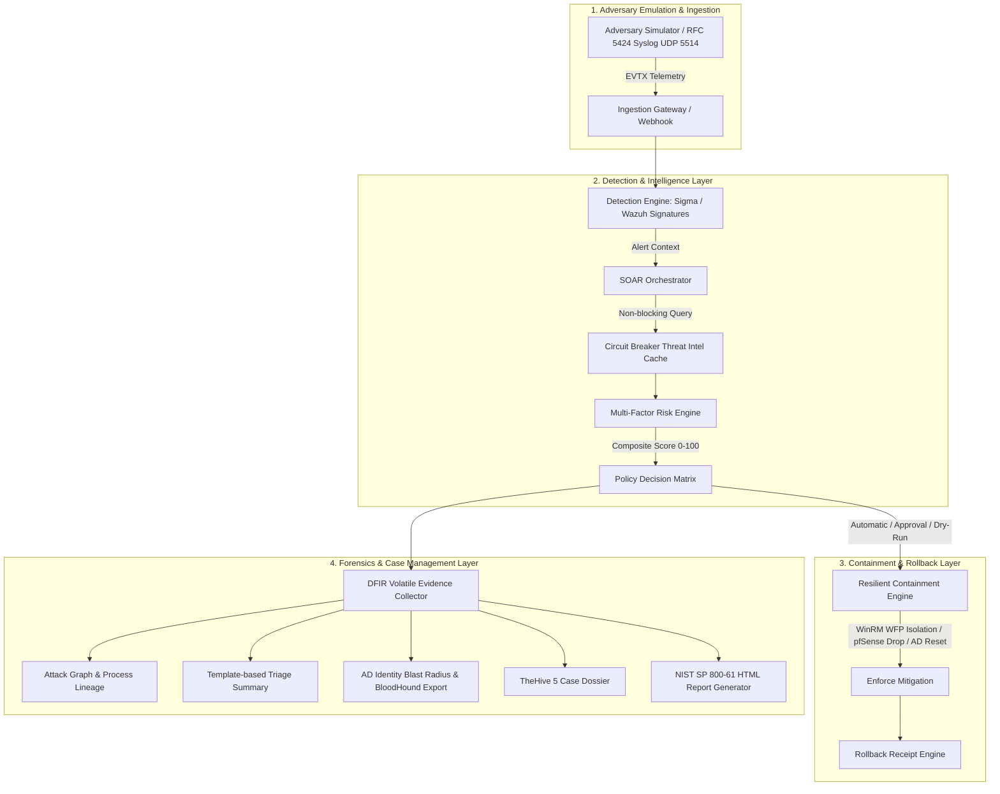

# 🛡️ CyberPulse SOC Suite: Detection Engineering & Resilient SOAR Architecture Lab

[](https://github.com/lumidren/CyberPulse-SOC-Suite/actions)


> **⚠️ LAB USE ONLY.** CyberPulse is a training and portfolio lab. **Never run the
> simulator, the SOAR engine or any deployment artefact against production
> systems or any network you do not own or are not explicitly authorised in
> writing to test.** The simulator only emits synthetic telemetry, but the
> configurations and playbooks describe real defensive actions.

**CyberPulse SOC Suite** is a modular **Detection Engineering, Incident Response (DFIR), and Resilient SOAR Architecture Lab** built in Python. It models how modern Security Operations Centers (SOCs) bridge the gap between adversary emulation, detection rule authoring, multi-factor risk scoring, automated containment, and forensic case management.

The project provides both **deployable configuration artifacts** (vendor-agnostic Sigma rules, Wazuh XML, Sysmon configurations, WDAC policies) and a **self-contained adversary emulation harness** for rapid testing without requiring a multi-server Active Directory cluster.

---

## 📐 Architectural Scope: Simulation Testbed vs. Deployable Artifacts

To maintain engineering transparency, the repository separates **deployable configuration artifacts** from the **Python simulation testbed**:

```
┌─────────────────────────────────────────────────────────────────────────────────────────────┐
│                             CYBERPULSE ARCHITECTURAL SCOPE                                  │
├──────────────────────────────────────────┬──────────────────────────────────────────────────┤
│ 1. Deployable Artifacts (untested)       │ 2. Python Simulation & Validation Harness        │
├──────────────────────────────────────────┼──────────────────────────────────────────────────┤
│ • 10+ Sigma YAML rules (Sysmon & Cloud)  │ • Adversary Emulation Generator (Sysmon/EVTX)    │
│ • Wazuh Manager XML detection rules      │ • Multi-Factor Risk & Policy Decision Engine     │
│ • Sysmon v14 XML auditing configuration  │ • Resilient Containment with Rollback Engine     │
│ • WDAC Kernel Driver Blocklist (XML)     │ • Pre-Containment DFIR Volatile Packager         │
│ • Splunk savedsearches.conf & inputs.conf│ • Template-based (offline) triage summary        │
│ • TheHive 5 Case templates (JSON)        │ • BloodHound CE v5 JSON Schema Exporter          │
│ • YARA signature rules                   │ • RFC 5424 Syslog UDP Receiver (Port 5514)       │
└──────────────────────────────────────────┴──────────────────────────────────────────────────┘
```

* **Deployable Configuration Artifacts (`rules/`, `deploy/`, `integrations/`)**: Vendor-agnostic rules and configurations in the formats Wazuh, Splunk, Windows endpoints and TheHive consume. They have only been exercised against this lab's synthetic events and are **untested against real-world noise**; tune them on your own baseline before relying on them.
* **Simulation Testbed (`simulator/`, `soar/`)**: Generates deterministic telemetry mimicking Windows Event Logs (Sysmon 1, 6, 10, 11; Security 4625, 4662, 4698, 4769; AWS CloudTrail; Azure SignInLogs). This enables rapid local testing, automated CI/CD verification, and interactive triage demonstrations without heavyweight infrastructure.
* **External Ingestion (`soar/syslog_receiver.py`)**: Accepts live RFC 5424 syslog packets over UDP 5514 or raw JSON via `POST /api/ingest`, enabling external agents or VMs to feed real telemetry into the pipeline.

---

## 🧑‍⚖️ Human Oversight

CyberPulse is built to **assist** analysts, not to replace them. Removing people
from the loop is not a goal of this project: automation proposes and records
actions, disruptive actions are meant to be approved by an analyst, and every
action is logged and reversible. See the safe-automation controls documented
under *SOAR Policies* below.

---

## 🔏 Privacy

The lab stores incidents, action records and ingested events **in memory only**;
all demo data is synthetic. See [`docs/PRIVACY.md`](docs/PRIVACY.md) for exactly what is
stored, for how long, and what leaves the machine.

---

## ⚠️ Limitations

Read this before drawing conclusions from anything else in the README.

* **It is a lab.** One Python process, in-memory state, no high availability.
  Restarting the server discards every incident.
* **Responders are simulated.** Containment actions (host isolation, firewall
  drops, account lockouts, token revocation) produce realistic action records
  but make **no** WinRM, pfSense, Active Directory, AWS or Microsoft Graph
  calls.
* **The simulator never performs attacks.** The LSASS "dump", brute force,
  DCSync and other scenarios return synthetic log records only; no process is
  opened, no memory is read and no credential is touched. A static-analysis
  test (`tests/test_simulator_is_telemetry_only.py`) enforces this.
* **Telemetry is synthetic.** Attack events come from `simulator/`, benign
  traffic from `simulator/benign_baseline.py`. Both were written by the same
  author as the rules, so detection counts are regression checks, not efficacy
  measurements (see [`docs/VALIDATION_RESULTS.md`](docs/VALIDATION_RESULTS.md)).
* **The rules are untested against real-world noise.** Every rule has only
  been run against synthetic events from this repository. Sigma rules are
  marked `status: experimental` for that reason; expect false positives on a
  real network until you tune them on your own baseline.
* **The Python detection engine is simpler than the Sigma rules.** The
  in-process matcher in `soar/soar_engine.py` does not yet apply the
  exclusions documented in `rules/sigma/`, which is why the benign baseline
  currently produces false positives.
* **Threat intelligence is a local, synthetic cache.** No live VirusTotal or
  AbuseIPDB lookups are made by the pipeline; reputation values are invented
  lab data.
* **Latency figures are in-process microseconds** on emulated traffic and say
  nothing about production SOC timing.
* **The "AI copilot" is template-based.** It fills text templates from
  incident fields; no language model is involved.
* **The identity graph and BloodHound export use a synthetic AD topology**,
  not a real directory.

---

## 🏛️ Closed-Loop Pipeline Architecture



---

## 🧰 Supported Security Platforms & Artifacts

| Platform / Tool | Artifact Location | Operational Role |
| :--- | :--- | :--- |
| **🛡️ Sysmon v14** | [`deploy/sysmon/sysmonconfig.xml`](deploy/sysmon/sysmonconfig.xml) | Kernel-level process handle, network socket, and driver load auditing. |
| **🛡️ WDAC Policies** | [`deploy/wdac/driver_blocklist_policy.xml`](deploy/wdac/driver_blocklist_policy.xml) | Windows Defender Application Control policy blocking vulnerable signed drivers (`T1068`). |
| **📜 Sigma Rules** | [`rules/sigma/`](rules/sigma/) | 10 vendor-agnostic detection rules covering Kerberoasting, DCSync, LSASS dumping, and cloud identity. |
| **📊 Splunk** | [`integrations/splunk/savedsearches.conf`](integrations/splunk/savedsearches.conf) | SPL correlation searches and `inputs.conf` Windows stream definitions. |
| **📑 TheHive 5** | [`integrations/thehive/thehive_case_template.json`](integrations/thehive/thehive_case_template.json) | Standardized NIST SP 800-61 6-stage incident triage case template. |
| **🌐 MISP** | [`integrations/misp/misp_event_cyberpulse.json`](integrations/misp/misp_event_cyberpulse.json) | Threat intelligence feed schema containing hashes, IPs, and MITRE galaxy tags. |
| **🔍 YARA** | [`rules/yara/soc_threat_signatures.yar`](rules/yara/soc_threat_signatures.yar) | Binary threat signatures for credential dumping and obfuscated cradles. |
| **🩸 BloodHound CE** | [`soar/bloodhound_exporter.py`](soar/bloodhound_exporter.py) | SharpHound/BloodHound CE v5 JSON graph exports (`users.json`, `groups.json`, `computers.json`). |

---

## 🧠 Multi-Factor Risk & Policy Decision Formula

Rather than relying strictly on static severity tags, CyberPulse computes an explainable composite risk score ($0.0 - 100.0$):

$$\text{Risk Score} = (S_{\text{rule}} \times 0.35) + (W_{\text{tactic}} \times 0.25) + (C_{\text{asset}} \times 0.15) + (P_{\text{user}} \times 0.10) + (I_{\text{intel}} \times 0.15) + B_{\text{repeat}}$$

### Weight Breakdown:
* **Detection Rule Base Confidence ($S_{\text{rule}}$)**: CRITICAL = 98.0, HIGH = 82.0, MEDIUM = 55.0.
* **MITRE ATT&CK Tactic Severity ($W_{\text{tactic}}$)**: Impact/Credential Access = 1.0, Defense Evasion = 0.95, Persistence = 0.85, Execution = 0.80, Initial Access = 0.75.
* **Asset Criticality Context ($C_{\text{asset}}$)**: Domain Controller (`WIN-DC01`) = 1.0, Finance Database = 0.90, Perimeter Gateway = 0.85, Standard Workstation = 0.60.
* **User Account Privilege ($P_{\text{user}}$)**: Domain Administrator = 1.0, Service Account = 0.80, Standard Domain User = 0.50.
* **Threat Intelligence Reputation ($I_{\text{intel}}$)**: VirusTotal positive ratio + AbuseIPDB confidence score ($0 - 100$).
* **Repeat Offender Context ($B_{\text{repeat}}$)**: $+5.0$ per previous incident from the same IP within a 1-hour window (capped at $+15.0$).

### Policy Playbook Matrix:
| Risk Tier | Score Range | Playbook Action | Containment Protocol | Rollback Capable |
| :--- | :--- | :--- | :--- | :---: |
| **CRITICAL** | **80.0 – 100.0** | Emergency Host Isolation & PID Termination | WinRM WFP Rule (Port 5986) | **Yes** |
| **HIGH** | **65.0 – 79.9** | Perimeter IP Drop / Account Session Revoke | pfSense API / Active Directory LDAP | **Yes** |
| **MEDIUM** | **40.0 – 64.9** | Threat Intel Enrichment & Triage Notification | Webhook Dispatch (Discord/Slack) | N/A |
| **LOW** | **0.0 – 39.9** | Baseline Event Recording & Background Audit | Internal Incident Store | N/A |

---

## 🎯 Detection Coverage Matrix

| Technique ID | Technique Name | Tactic | Primary Telemetry | Rule ID | Playbook Response |
| :--- | :--- | :--- | :--- | :--- | :--- |
| **`T1003.001`** | LSASS Memory Dumping | Credential Access | Sysmon Event 10 | `SOC-RULE-001` | WinRM WFP Host Isolation + PID Kill |
| **`T1110.001`** | RDP Password Guessing | Credential Access | Security Event 4625 | `SOC-RULE-002` | pfSense REST API IP Drop |
| **`T1053.005`** | Scheduled Task Hook | Persistence | Security Event 4698 | `SOC-RULE-003` | Remote Task De-registration |
| **`T1059.001`** | Obfuscated PowerShell | Execution | Sysmon Event 1 | `SOC-RULE-004` | Process Kill + AD Account Lockout |
| **`T1562.001`** | Defender Impairment | Defense Evasion | Sysmon Event 1 | `SOC-RULE-005` | Revert Policy + Host Isolation |
| **`T1486`** | Ransomware Canary Encryption | Impact | Sysmon Event 11 | `SOC-RULE-006` | PID Kill + VSS Snapshot Recovery |
| **`T1558.001`** | Kerberoasting TGS Request | Credential Access | Security Event 4769 | `SOC-RULE-007` | Reset Service Account & Revoke Ticket |
| **`T1003.006`** | AD Replication Abuse (DCSync) | Credential Access | Security Event 4662 | `SOC-RULE-008` | Isolate Account & Revoke Privileges |
| **`T1548`** | Cross-Account STS AssumeRole | Privilege Escalation | AWS CloudTrail | `SOC-RULE-009` | Attach Deny Policy & Invalidate STS |
| **`T1078`** | Entra ID Impossible Travel | Initial Access | Azure SignInLogs | `SOC-RULE-010` | Revoke Refresh Tokens & Enforce MFA |
| **`T1068`** | Vulnerable Driver Load (BYOVD) | Defense Evasion | Sysmon Event 6 | `SOC-RULE-011` | Unload Driver & Enforce WDAC Block |

---

## ⏱️ Pipeline Latency (Lab-Measured on Emulated Traffic)

> **Every number in this section is lab-measured on emulated telemetry.** It is
> in-process wall-clock time for synthetic events: detection runs on generated
> logs, enrichment reads a local cache, and responders are simulated (no WinRM,
> pfSense or AD calls). It is **not** a production SOC latency and should not be
> compared with one.

Reproduce with `python scripts/benchmark_pipeline.py --runs 20` (DRY_RUN mode,
10 generators × 20 runs = 200 events). Measured on 2026-10-31, Windows 11,
Python 3.12.2:

| Pipeline Stage | p50 | p95 | What is actually measured |
| :--- | :---: | :---: | :--- |
| **Detection & Matching** | 1 µs | 2 µs | Python rule evaluation over one synthetic event. |
| **Threat Intel Enrichment** | 1 µs | 2 µs | Dictionary lookup in the local IoC cache (no external API). |
| **Containment (simulated)** | 4 µs | 7 µs | Building the simulated action record; no network I/O. |
| **Total In-Process Pipeline** | 7 µs | 11 µs | Sum of the three stages above. |

Real-world latency would be dominated by log shipping, SIEM indexing, API
round-trips and responder execution, none of which this lab measures yet
(**not yet measured**).

---

## 🔐 API Security & Hardening

All REST endpoints under `/api/*` require authentication to prevent unauthorized containment or simulation triggers:

* **Header Authentication**: Provide `X-API-Key: <token>` or `Authorization: Bearer <token>` (validated with a constant-time comparison).
* **Configurable Secret**: Set via the `CYBERPULSE_API_KEY` environment variable. In development, if it is unset, the server generates a random key for that run and prints it once on the console (there is no hardcoded fallback); with `CYBERPULSE_ENV=production` the server **refuses to start** without an explicit key. Keep real keys in `.env` (git-ignored) or a secrets manager.
* **CORS Restrictions**: `Access-Control-Allow-Origin` is restricted to authorized origins (configurable via `CORS_ALLOWED_ORIGIN`, defaulting to `http://localhost:5000`).
* **Rate Limiting**: Sliding-window per-client limits — `RATE_LIMIT_PER_MINUTE` (default 240) for all API traffic plus `AUTH_FAILURE_LIMIT_PER_MINUTE` (default 10) for failed authentication attempts, returning `429` when saturated.
* **Request Hardening**: JSON bodies are strictly validated (`400` on malformed payloads) and capped at `MAX_BODY_BYTES` (default 1 MiB → `413`); every response carries `X-Content-Type-Options`, `X-Frame-Options`, and `Referrer-Policy` headers.
* **SSRF Guard**: Analyst-supplied webhook URLs must be `http(s)` and may not target loopback/private/link-local addresses unless `ALLOW_INTERNAL_WEBHOOKS=true`.
* **Observability**: Structured logs plus a dedicated audit trail for state-changing actions (simulations, rollbacks, policy changes); an unauthenticated `/healthz` liveness probe and `GET /api/version` support load balancers and container healthchecks.
* **Concurrency & Lifecycle**: Threaded HTTP server (slow clients cannot stall the console), graceful SIGINT/SIGTERM shutdown, and pagination (`?limit=&offset=`) on `GET /api/incidents`.

See [SECURITY.md](SECURITY.md) for the full hardening baseline and deployment guidance, and [CHANGELOG.md](CHANGELOG.md) for release history.

---

## 🚀 Quickstart & Setup Guide

### 1. Prerequisites & Installation:
```bash
# Clone the repository
git clone https://github.com/lumidren/CyberPulse-SOC-Suite.git
cd CyberPulse-SOC-Suite

# Create and activate a virtual environment
python -m venv venv
# On Windows:
.\venv\Scripts\activate
# On Linux / macOS:
source venv/bin/activate

# Install dependencies (hash-pinned; dev tools are only needed for tests/lint)
pip install --require-hashes -r requirements.txt
pip install --require-hashes -r requirements-dev.txt
```

### 2. Run the Automated Test Suite (35+ Unit & Integration Tests):
```bash
python -m unittest discover -s tests -p "test_*.py" -v
```

### 3. Launch the Web Operations Console:
```bash
python server.py
```
Open **`http://localhost:5000`** in your browser to access:
* **SOC Overview**: GeoIP threat map, operational KPI meters, and attack simulation launcher.
* **Incident DFIR**: Interactive attack graph, template-based triage summary, pre-containment volatile evidence box, Active Directory identity blast radius, and 1-click rollback.
* **Detection Catalogue**: Searchable rulebase linked to Detection Engineering Lifecycle (DELC) write-ups.
* **SOAR Policies**: Risk tier configuration and Dry-Run mode toggles.
* **Purple Team Replay**: Interactive APT29 and LockBit kill chain execution.
* **System Health**: Connection probes for Wazuh, OpenSearch, WinRM, and external APIs.
* **Live Ingestion & Syslog**: Live UDP 5514 listener statistics and interactive webhook ingestion gateway.

---

## 💼 Portfolio Summary (Accurate Resume Lines)

Each line below describes something a reader can verify in this repository.
Lab scope is stated explicitly so the lines survive a technical interview.

```text
CyberPulse SOC Lab – Detection Engineering & SOAR Simulation (personal lab project)
GitHub: https://github.com/lumidren/CyberPulse-SOC-Suite
• Built a single-process Python lab that replays synthetic Windows/cloud telemetry through
  detection, multi-factor risk scoring and simulated containment (no live responders).
• Wrote Sigma (status: experimental) and Wazuh XML rules for LSASS access, RDP brute force,
  Kerberoasting, DCSync, BYOVD driver loads and AWS/Entra abuse; validated only on
  self-authored synthetic events (counts in docs/VALIDATION_RESULTS.md).
• Built a seeded benign-baseline generator and a validation script that publishes scripted
  detection counts and false-positive counts, including the false positives it finds.
• Implemented simulated containment with dry-run/approval modes, a circuit breaker and
  rollback records for host isolation, firewall drops and token revocation.
• Added a template-based (non-LLM) triage summary, attack-graph view, synthetic AD blast-radius
  analysis and a BloodHound CE-format export of the synthetic topology.
• Hardened the lab REST API (constant-time key auth, rate limiting, SSRF guard, body limits,
  audit logging) and ran the test suite in GitHub Actions on Python 3.10-3.12.
```
